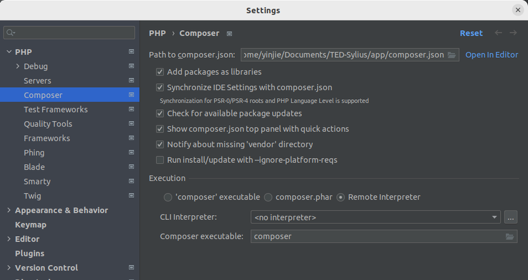
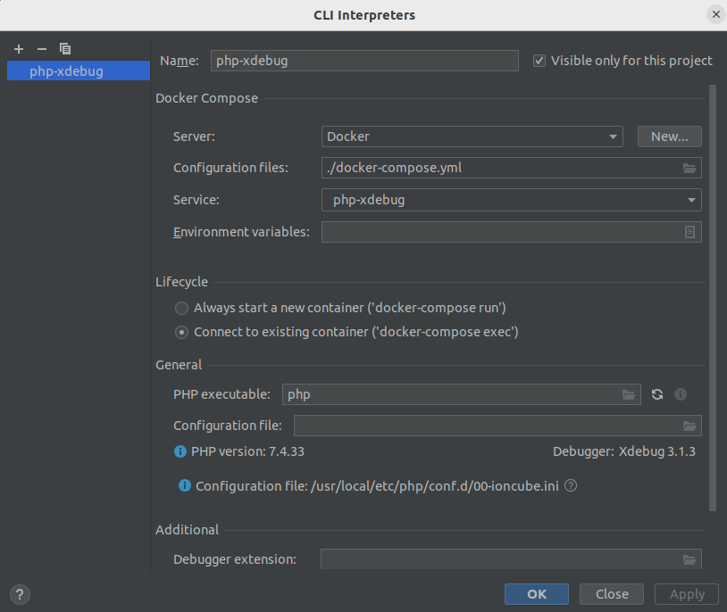
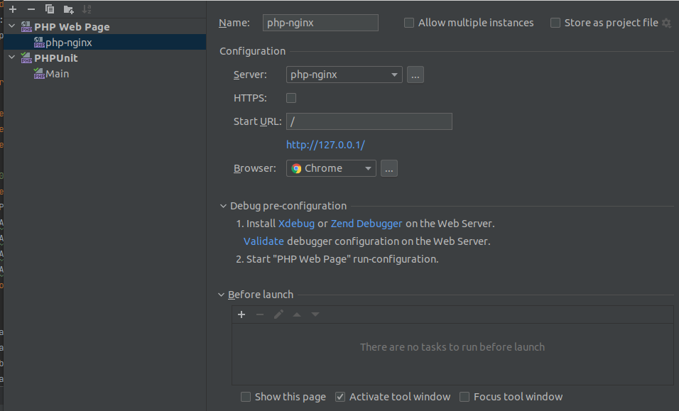
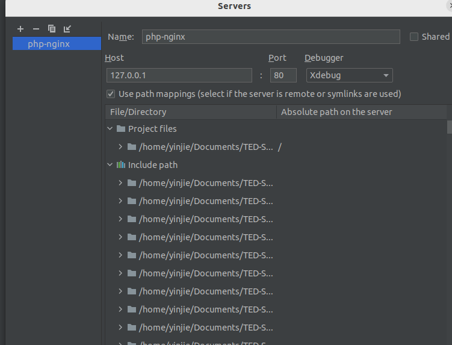
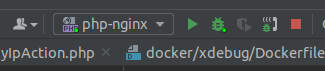
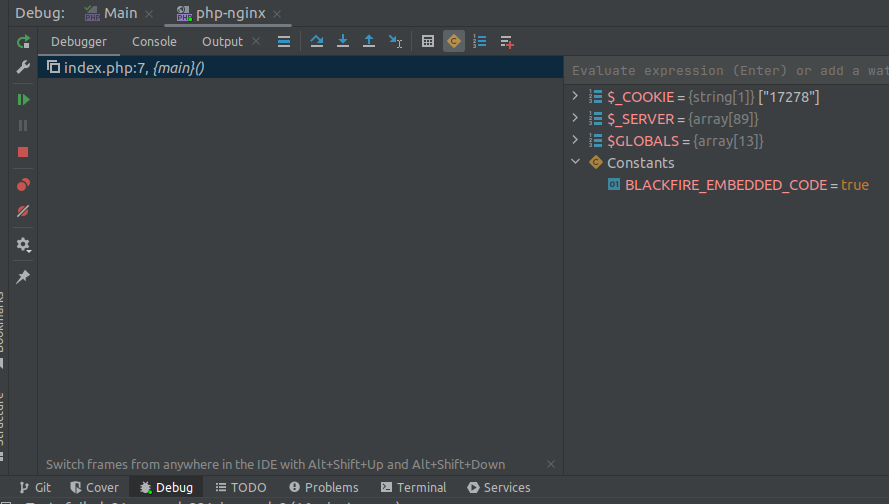
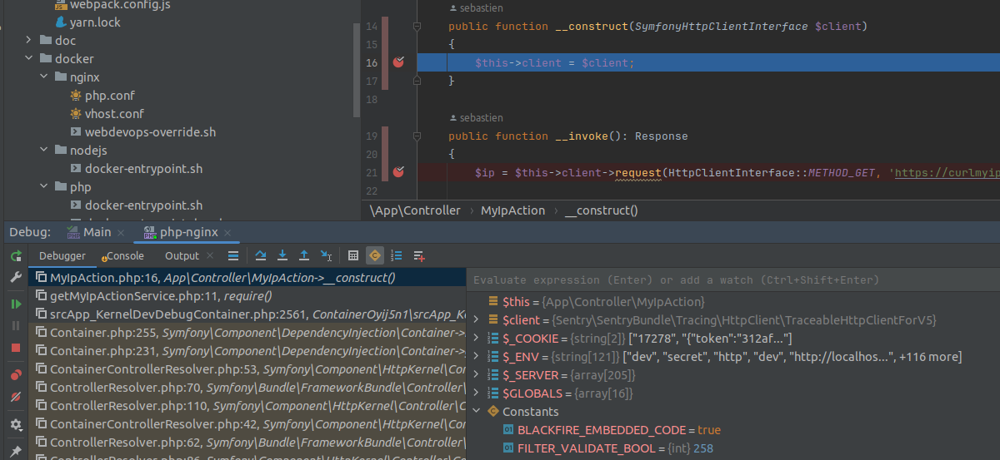

Install Xdebug with PhpStorm
==========

- Go to Composer section in the settings of PhpStorm and open the CLI Interpreter Menu

    

- Add a new interpreter by choosing Docker and fill with following information

    ```shell
    Server: Docker
    Configuraiton file; ./compose.yml
    Service: php-nginx
    Apply the changes
    ``` 

- We can choose to run in an existing container
   
    

- Launch the xdebug service 

    ```shell
    XDEBUG_MODE=debug docker compose up php-nginx -d
    ```
- Add a new configuration PHP Web Page in order to debug when launching server

    

- Add a new server if it didn't exist and activate path mapping \
- Add **/** to project root

    

- Start the PhpStorm Debug Process by clicking the bug button

    

- We can now debug in PhpStorm with XDebug

    

- Resume the program until we get to the correct breakpoint

    

---

For the **coverage test** in PhpStorm, we need to change the configuration to Main PHPUnit
An then, we are prepared to launch the test. We can use the button near the bug button.

The html report will be stored at **/app/coverage** in container
